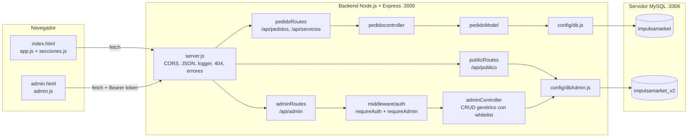
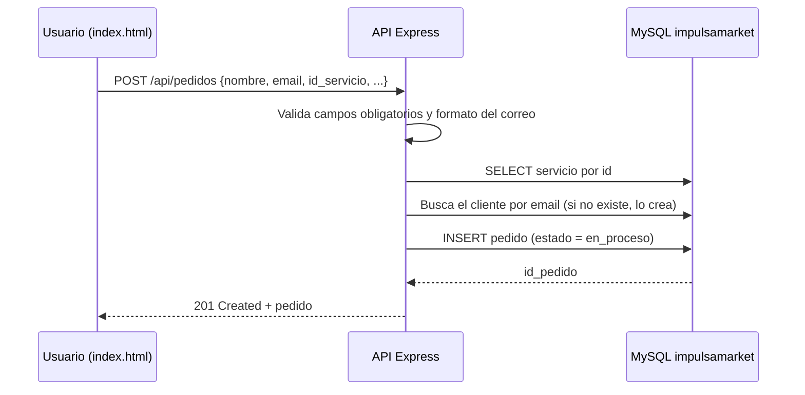
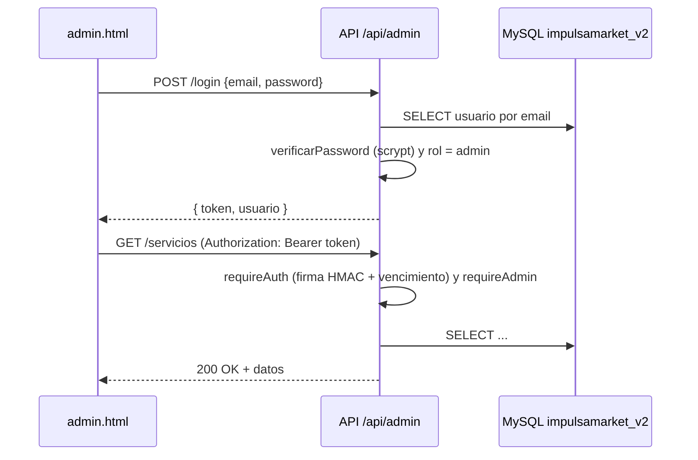
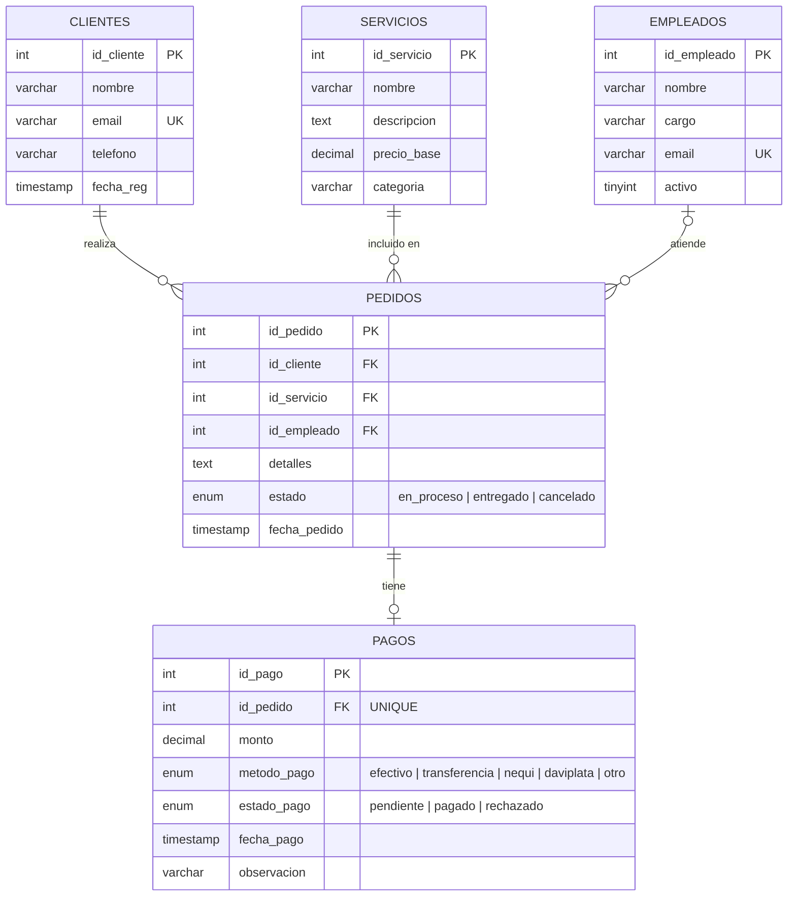
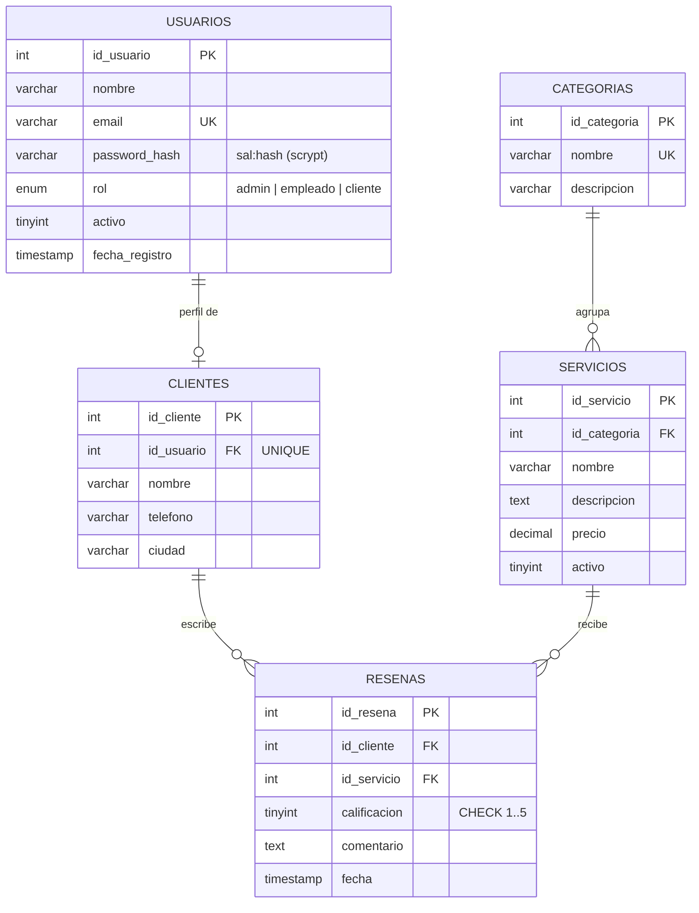

# ImpulsaMarket

Plataforma web para una agencia de **diseño gráfico y marketing digital**. Los clientes pueden ver el catálogo de servicios, hacer pedidos y leer reseñas. Los administradores gestionan la información desde un panel privado.

> Proyecto de Media Técnica: frontend en HTML/CSS/JS puro y una API REST en Node.js + Express + MySQL.

---

## Tabla de contenido

1. [Características](#características)
2. [Tecnologías](#tecnologías)
3. [Arquitectura](#arquitectura)
4. [Estructura de carpetas](#estructura-de-carpetas)
5. [Modelo de base de datos](#modelo-de-base-de-datos)
6. [Endpoints de la API](#endpoints-de-la-api)
7. [Autenticación y seguridad](#autenticación-y-seguridad)
8. [Instalación y ejecución](#instalación-y-ejecución)
9. [Usuarios de prueba](#usuarios-de-prueba)
10. [Solución de problemas](#solución-de-problemas)
11. [Mejoras pendientes](#mejoras-pendientes)

---

## Características

**Sitio público (`index.html`)**
- Página de inicio con las secciones: hero, servicios, proceso, testimonios y aliados.
- Catálogo de servicios que se carga desde la API.
- Formulario para crear un pedido (nombre, correo, teléfono, servicio y detalles).
- Contadores de pedidos: total, en proceso, entregados y cancelados.
- Panel rápido de pedidos para editar el estado o eliminar pedidos.
- Las 6 reseñas más recientes de clientes.

**Panel de administración (`admin.html`)**
- Inicio de sesión con correo y contraseña. Solo pueden entrar usuarios con rol `admin`.
- Resumen con totales y la calificación promedio de las reseñas.
- CRUD completo de **usuarios, categorías, servicios, clientes y reseñas**.
- Validaciones en el servidor y mensajes de error claros (registros duplicados, llaves foráneas, etc.).

---

## Tecnologías

| Capa | Tecnología | Uso |
|---|---|---|
| Frontend | HTML5, CSS3, JavaScript (Vanilla, `fetch`) | Interfaz del sitio y del panel |
| Frontend | Google Fonts (Playfair Display, DM Sans) | Tipografía |
| Backend | [Node.js](https://nodejs.org/) | Entorno de ejecución |
| Backend | [Express 4](https://expressjs.com/) | Servidor HTTP y rutas REST |
| Backend | [mysql2](https://github.com/sidorares/node-mysql2) (`promise`) | Pool de conexiones y consultas parametrizadas |
| Backend | [dotenv](https://github.com/motdotla/dotenv) | Variables de entorno |
| Backend | [cors](https://github.com/expressjs/cors) | Peticiones desde otro origen (Live Server) |
| Backend | `crypto` (módulo nativo de Node) | Hash de contraseñas (scrypt) y tokens con firma HMAC |
| Desarrollo | [nodemon](https://nodemon.io/) | Reinicia el servidor al guardar cambios |
| Base de datos | MySQL 8 / MariaDB (InnoDB, `utf8mb4`) | Guardar los datos |
| Herramientas | VS Code + Live Server (puerto 5501) | Servir el frontend en local |

---

## Arquitectura

El proyecto tiene **tres capas**. El frontend es estático y le habla a la API por HTTP/JSON. La API se conecta a **dos bases de datos MySQL**:

- **`impulsamarket`** (v1): pedidos, servicios, clientes, empleados y pagos. La usa el sitio público.
- **`impulsamarket_v2`** (v2): usuarios, categorías, servicios, clientes y reseñas. La usan el panel de administración y las reseñas públicas.



### Patrón del backend

El backend usa una estructura **por capas (tipo MVC, sin vistas)**:

| Capa | Archivo(s) | Qué hace |
|---|---|---|
| Entrada | `src/server.js` | Configura Express, los middlewares globales y monta las rutas |
| Rutas | `src/routes/*.js` | Une cada URL y método HTTP con su controlador |
| Middleware | `src/middleware/auth.js` | Revisa el token y el rol de administrador |
| Controladores | `src/controllers/*.js` | Valida la petición y arma la respuesta HTTP |
| Modelos | `src/models/pedidoModel.js` | Consultas SQL de los pedidos |
| Configuración | `src/config/db.js`, `src/config/dbAdmin.js` | Un pool de conexiones para cada base de datos |
| Utilidades | `src/utils/auth.js` | Hash de contraseñas y manejo de tokens |

El `adminController` hace un **CRUD genérico** a partir del objeto `ENTIDADES`. Para cada entidad se define la tabla, la llave primaria, los campos permitidos (whitelist), los campos obligatorios y la consulta para listar. `adminRoutes` recorre ese objeto y crea las rutas `GET / POST / PUT / DELETE` de cada entidad.

### Flujo: crear un pedido



### Flujo: login en el panel



---

## Estructura de carpetas

```text
impulsamarket/
├── backend/
│   ├── .env                      # Variables de entorno (no se sube al repositorio)
│   ├── package.json
│   ├── src/
│   │   ├── server.js             # Punto de entrada de la API
│   │   ├── config/
│   │   │   ├── db.js             # Pool para la BD impulsamarket (v1)
│   │   │   └── dbAdmin.js        # Pool para la BD impulsamarket_v2
│   │   ├── controllers/
│   │   │   ├── pedidocontroller.js
│   │   │   └── adminController.js
│   │   ├── middleware/
│   │   │   └── auth.js           # requireAuth / requireAdmin
│   │   ├── models/
│   │   │   └── pedidoModel.js
│   │   ├── routes/
│   │   │   ├── pedidoRoutes.js   # /api/pedidos, /api/servicios
│   │   │   ├── publicRoutes.js   # /api/publico/resenas
│   │   │   └── adminRoutes.js    # /api/admin/*
│   │   └── utils/
│   │       └── auth.js           # scrypt + tokens HMAC
│   └── utils/
│       ├── auth.js               # Copia de src/utils/auth.js
│       └── crearAdmin.js         # Script para crear o actualizar un admin (ver nota)
├── database/
│   ├── impulsamarket.sql         # Script de la BD v1 (tablas, datos de prueba y vistas)
│   └── impulsamarket_v2.sql      # Script de la BD v2 (usuarios, reseñas, etc.)
└── frontend/
    ├── index.html                # Sitio público
    ├── admin.html                # Panel de administración
    ├── css/
    │   ├── styles.css
    │   ├── secciones.css
    │   └── admin.css
    └── js/
        ├── app.js                # Servicios y pedidos
        ├── secciones.js          # Reseñas públicas
        └── admin.js              # Lógica del panel
```

---

## Modelo de base de datos

### BD v1: `impulsamarket` (sitio público y pedidos)



| Relación | Cardinalidad | Al borrar el padre |
|---|---|---|
| clientes → pedidos | 1 : N | `CASCADE` (se borran sus pedidos) |
| servicios → pedidos | 1 : N | `RESTRICT` (no deja borrar un servicio que tenga pedidos) |
| empleados → pedidos | 1 : N (opcional) | `SET NULL` |
| pedidos → pagos | 1 : 0..1 | `CASCADE` |

**Vistas:**
- `v_pedidos_detalle`: cada pedido con los datos del cliente, el servicio, el empleado y el pago.
- `v_estadisticas`: pedidos por estado, ingresos totales e ingresos cobrados.

**Datos de prueba:** 5 servicios, 5 empleados, 10 clientes, 12 pedidos y 12 pagos.

### BD v2: `impulsamarket_v2` (panel de administración)



| Llave foránea | Relación | Al borrar / actualizar |
|---|---|---|
| `fk_cliente_usuario` | usuarios → clientes (1 : 0..1) | `CASCADE` / `CASCADE` |
| `fk_servicio_categoria` | categorias → servicios (1 : N) | `RESTRICT` / `CASCADE` |
| `fk_resena_cliente` | clientes → resenas (1 : N) | `CASCADE` / `CASCADE` |
| `fk_resena_servicio` | servicios → resenas (1 : N) | `CASCADE` / `CASCADE` |

**Datos de prueba:** 5 usuarios, 3 categorías, 5 servicios, 3 clientes y 4 reseñas.

---

## Endpoints de la API

URL base: `http://localhost:3000`

### Generales y públicos

| Método | Ruta | Descripción | BD |
|---|---|---|---|
| GET | `/` | Revisa que la API esté en línea y lista los endpoints | — |
| GET | `/api/servicios` | Lista los servicios, ordenados por precio | v1 |
| GET | `/api/servicios/:id` | Detalle de un servicio | v1 |
| GET | `/api/pedidos` | Lista los pedidos con cliente, servicio y empleado | v1 |
| GET | `/api/pedidos/stats` | Cantidad de pedidos por estado | v1 |
| GET | `/api/pedidos/:id` | Detalle de un pedido | v1 |
| POST | `/api/pedidos` | Crea un pedido y crea el cliente si no existe | v1 |
| PUT | `/api/pedidos/:id` | Cambia `estado`, `detalles` o `id_empleado` | v1 |
| DELETE | `/api/pedidos/:id` | Elimina un pedido | v1 |
| GET | `/api/publico/resenas` | Las 6 reseñas más recientes, sin datos privados | v2 |

**Ejemplo para crear un pedido:**

```bash
curl -X POST http://localhost:3000/api/pedidos \
  -H "Content-Type: application/json" \
  -d '{"nombre_cliente":"Ana Ruiz","email_cliente":"ana@correo.com","telefono_cliente":"3000000000","id_servicio":1,"detalles":"Logo para cafetería"}'
```

### Administración (`/api/admin`), BD v2

| Método | Ruta | Requiere token | Descripción |
|---|---|---|---|
| POST | `/api/admin/login` | No | Devuelve `{ token, usuario }` si el usuario es admin |
| GET | `/api/admin/resumen` | Sí (admin) | Totales por tabla y calificación promedio |
| GET | `/api/admin/:entidad` | Sí (admin) | Lista los registros |
| POST | `/api/admin/:entidad` | Sí (admin) | Crea un registro |
| PUT | `/api/admin/:entidad/:id` | Sí (admin) | Actualiza un registro |
| DELETE | `/api/admin/:entidad/:id` | Sí (admin) | Elimina un registro |

`:entidad` puede ser `usuarios`, `categorias`, `servicios`, `clientes` o `resenas`.

Las rutas protegidas necesitan este encabezado:

```http
Authorization: Bearer <token>
```

**Códigos de respuesta:** `200` OK · `201` creado · `400` datos inválidos · `401` sesión no válida · `403` sin permisos · `404` no encontrado · `409` duplicado o con registros relacionados · `500` error interno.

---

## Autenticación y seguridad

- **Contraseñas:** se guardan con `crypto.scryptSync` y una sal aleatoria de 16 bytes, en formato `sal:hash`. Para compararlas se usa `timingSafeEqual`.
- **Sesión:** un token propio parecido a un JWT (`payload.firma`). El payload va en base64url (`{ id, rol, exp }`) y la firma es HMAC-SHA256 con `AUTH_SECRET`. Dura **8 horas**.
- **Autorización:** `requireAuth` revisa la firma y el vencimiento del token. `requireAdmin` exige `rol = 'admin'`.
- **SQL injection:** todas las consultas usan parámetros (`?`). En el CRUD genérico, los nombres de las columnas salen de una whitelist fija y nunca de lo que envía el cliente.
- **Reglas de negocio:** un admin no puede eliminarse a sí mismo, quitarse el rol ni desactivar su propia cuenta.

---

## Instalación y ejecución

### Requisitos

- [Node.js](https://nodejs.org/) 18 o superior (incluye npm)
- MySQL 8 o MariaDB 10.4+ (sirven XAMPP, WAMP o MySQL Workbench)
- VS Code con la extensión **Live Server** (u otro servidor estático)

### 1. Crear las bases de datos

Ejecuta los **dos** scripts SQL. Cada uno crea su base de datos desde cero.

> ⚠️ Los scripts empiezan con `DROP DATABASE IF EXISTS`. Si ya tienes datos en esas bases, se van a borrar.

```bash
# Desde la carpeta impulsamarket/
mysql -u root -p < database/impulsamarket.sql
mysql -u root -p < database/impulsamarket_v2.sql
```

También puedes abrir cada archivo en **phpMyAdmin** o **MySQL Workbench** y ejecutarlo.

### 2. Configurar las variables de entorno

Crea (o edita) el archivo `backend/.env`:

```env
# Servidor
PORT=3000

# MySQL
DB_HOST=localhost
DB_PORT=3306
DB_USER=root
DB_PASSWORD=tu_contraseña

# Bases de datos
DB_NAME=impulsamarket
DB_NAME_V2=impulsamarket_v2

# Secreto para firmar los tokens del panel (usa una cadena larga y aleatoria)
AUTH_SECRET=cambia-esto-por-un-secreto-largo
```

| Variable | Valor por defecto | Descripción |
|---|---|---|
| `PORT` | `3000` | Puerto de la API |
| `DB_HOST` | `localhost` | Host de MySQL |
| `DB_PORT` | `3306` | Puerto de MySQL |
| `DB_USER` | `root` | Usuario de MySQL |
| `DB_PASSWORD` | *(vacío)* | Contraseña de MySQL |
| `DB_NAME` | `impulsamarket` | BD v1 (pedidos) |
| `DB_NAME_V2` | `impulsamarket_v2` | BD v2 (panel) |
| `AUTH_SECRET` | `impulsamarket-cambia-este-secreto` | Secreto HMAC para los tokens. **Cámbialo en producción** |

### 3. Instalar dependencias y levantar la API

```bash
cd backend
npm install

# Desarrollo (se reinicia sola con nodemon)
npm run dev

# Producción
npm start
```

Si todo sale bien, verás:

```text
✅  MySQL conectado → base de datos: impulsamarket
🚀 ImpulsaMarket API → http://localhost:3000
```

Para comprobarlo, abre http://localhost:3000 en el navegador.

### 4. Levantar el frontend

El frontend no necesita compilarse. Elige una opción:

- **VS Code + Live Server:** clic derecho sobre `frontend/index.html` → *Open with Live Server*. Abre en `http://127.0.0.1:5501` (puerto configurado en `.vscode/settings.json`).
- **Cualquier servidor estático**, por ejemplo:
  ```bash
  npx serve frontend
  ```

Páginas:
- Sitio público: `http://127.0.0.1:5501/index.html`
- Panel de administración: `http://127.0.0.1:5501/admin.html`

> La dirección de la API está escrita directamente en `frontend/js/app.js`, `frontend/js/admin.js` y `frontend/js/secciones.js` (`http://localhost:3000`). Si cambias el puerto o el host, actualízala en esos tres archivos.

### 5. (Opcional) Crear o restablecer un administrador

El script `crearAdmin.js` crea un usuario admin o le cambia la contraseña si ya existe:

```bash
cd backend
node src/utils/crearAdmin.js correo@ejemplo.com MiClave123 "Mi Nombre"
```

> **Nota:** hoy el script está en `backend/utils/crearAdmin.js` y hace `require('../config/dbAdmin')`. Esa ruta solo existe si el archivo está dentro de `backend/src/utils/`. Muévelo (o cópialo) a `backend/src/utils/` antes de correr el comando de arriba.

---

## Usuarios de prueba

Vienen en `database/impulsamarket_v2.sql`:

| Rol | Correo | Contraseña |
|---|---|---|
| admin | `admin@impulsamarket.co` | `Admin123*` |
| empleado | `empleado@impulsamarket.co` | `Empleado123*` |
| cliente | `cliente1@correo.com` (también `cliente2`, `cliente3`) | `Cliente123*` |

> Solo el rol **admin** puede entrar a `admin.html`. **Cambia estas contraseñas antes de publicar el proyecto.**

---

## Solución de problemas

| Problema | Causa probable | Solución |
|---|---|---|
| `❌ Error al conectar MySQL` y la API se cierra | MySQL apagado o credenciales mal escritas | Enciende MySQL y revisa `DB_USER` y `DB_PASSWORD` en `.env` |
| `ER_BAD_DB_ERROR` | No se ejecutaron los scripts SQL | Ejecuta los dos archivos de `database/` |
| El panel muestra "No se pudo conectar" o *Failed to fetch* | La API no está corriendo o el puerto es otro | Corre `npm run dev` y revisa la URL en `admin.js` |
| `401 Sesión no válida o vencida` | El token venció (8 h) o cambiaste `AUTH_SECRET` | Cierra sesión y vuelve a entrar |
| Las reseñas no aparecen en el inicio | La BD `impulsamarket_v2` no existe | Ejecuta `impulsamarket_v2.sql` |
| `No se puede eliminar: tiene registros relacionados` | Una llave foránea con `RESTRICT` | Primero elimina o reasigna los registros que dependen de ese |

---

## Mejoras pendientes

- [ ] **Proteger las rutas de `/api/pedidos`.** Hoy cualquiera puede editar y borrar pedidos sin iniciar sesión.
- [ ] Limitar CORS a los orígenes conocidos en lugar de `*`.
- [ ] Unificar las dos bases de datos (v1 y v2) en un solo esquema.
- [ ] Quitar la carpeta duplicada `backend/utils/` y dejar `crearAdmin.js` en `src/utils/`.
- [ ] Agregar un archivo `backend/.env.example` y leer la URL de la API desde la configuración del frontend.
- [ ] Mostrar la tabla `pagos` y las vistas (`v_pedidos_detalle`, `v_estadisticas`) a través de la API.
- [ ] Agregar pruebas automáticas (Jest + Supertest) y limitar los intentos de login (rate limiting).

---

## Licencia

ISC © ImpulsaMarket

