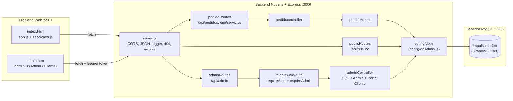
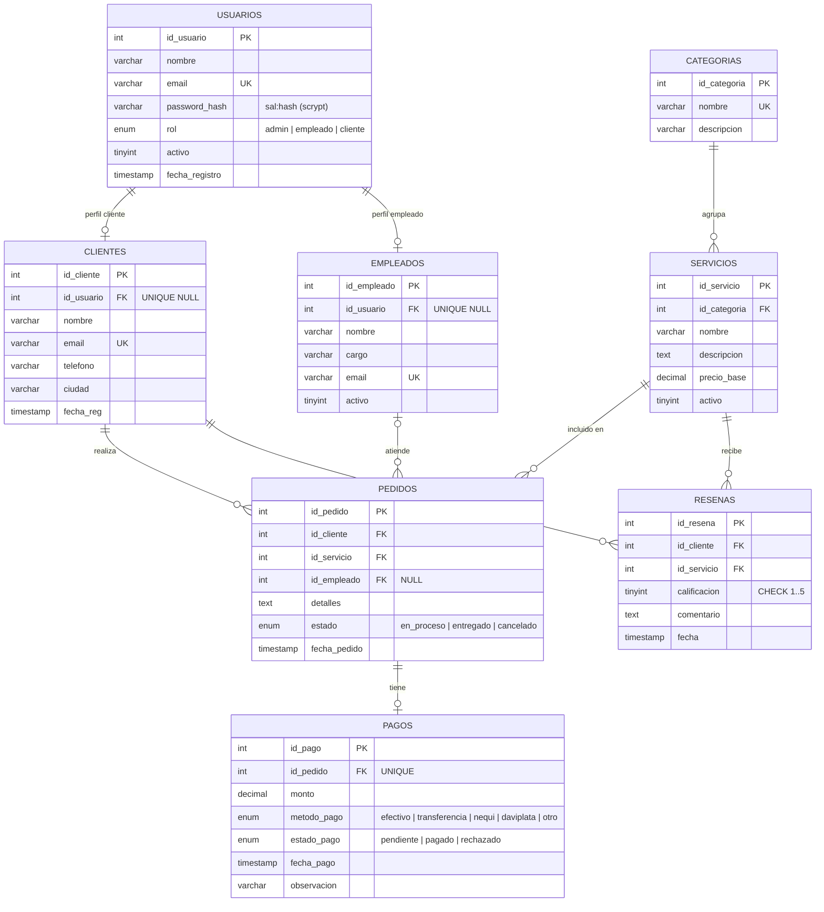

# ImpulsaMarket

Plataforma web para una agencia de **diseño gráfico y marketing digital**. Los visitantes pueden explorar el catálogo de servicios, cotizar y registrarse como clientes. Los **clientes** cuentan con un portal propio para gestionar sus pedidos y reseñas, y los **administradores** gestionan las 8 tablas del sistema desde un panel privado conectado a una única base de datos relacional.

> Proyecto de Media Técnica: frontend en HTML/CSS/JS puro y una API REST en Node.js + Express + MySQL.

---

## Tabla de contenido

1. [Características](#características)
2. [Tecnologías](#tecnologías)
3. [Arquitectura](#arquitectura)
4. [Estructura de carpetas](#estructura-de-carpetas)
5. [Modelo de base de datos](#modelo-de-base-de-datos)
6. [Endpoints de la API](#endpoints-de-la-api)
7. [Autenticación y seguridad](#autenticación-y-seguridad)
8. [Instalación y ejecución](#instalación-y-ejecución)
9. [Usuarios de prueba](#usuarios-de-prueba)
10. [Solución de problemas](#solución-de-problemas)

---

## Características

**Sitio público (`index.html`)**
- Página de inicio con las secciones: hero, servicios, proceso, testimonios y aliados.
- Catálogo de servicios activos que se carga desde la API (vinculados con su categoría).
- Barra de navegación con acceso a **Iniciar sesión**, **Registrarse** o ver la sesión activa (`👤 Nombre · Mi Cuenta / Panel Admin`).
- Formulario para crear un pedido (autocompleta nombre, correo y teléfono si el usuario tiene sesión iniciada).
- Contadores en tiempo real de pedidos: total, en proceso, entregados y cancelados.
- Las 6 reseñas más recientes de clientes.
- Botón flotante `⚙ Panel Admin` (exclusivo y visible únicamente cuando se inicia sesión como **administrador**).

**Portal del Cliente (`admin.html` — rol `cliente`)**
- **Registro público de clientes:** crea la cuenta en `usuarios` (`rol = 'cliente'`) y la vincula automáticamente con su perfil en `clientes`.
- **📦 Mis Pedidos (CRUD inteligente según el estado):**
  - Solicitar nuevos pedidos.
  - **En proceso (`⏳`):** editar detalles o servicio (si aún no está pagado) y **cancelar** el pedido (pasa automáticamente pagos pendientes a `rechazado`).
  - **Entregado (`✅`):** botón directo **`⭐ Calificar`** para publicar una reseña sobre ese servicio.
  - **Cancelado (`❌`):** **reactivar** el pedido (vuelve a `en_proceso`) o **eliminarlo** si no tiene pago aprobado.
- **⭐ Mis Reseñas (CRUD completo):** publicar, editar calificación/comentario y eliminar reseñas propias.
- **👤 Mis Datos:** actualizar nombre, teléfono, ciudad y contraseña.

**Panel de Administración (`admin.html` — rol `admin`)**
- Tablero de **Resumen** con totales de las 8 tablas, calificación promedio de las reseñas e ingresos cobrados.
- CRUD completo de **pedidos, pagos, servicios, categorías, clientes, empleados, reseñas y usuarios**.
- Validaciones en el servidor y mensajes de error claros (registros duplicados, llaves foráneas, etc.).

---

## Tecnologías

| Capa | Tecnología | Uso |
|---|---|---|
| Frontend | HTML5, CSS3, JavaScript (Vanilla, `fetch`) | Interfaz del sitio, portal de clientes y panel admin (puerto `5501`) |
| Frontend | Google Fonts (Playfair Display, DM Sans) | Tipografía |
| Backend | [Node.js](https://nodejs.org/) | Entorno de ejecución |
| Backend | [Express 4](https://expressjs.com/) | Servidor HTTP de la API (puerto `3000`) y servidor estático del frontend (puerto `5501`) |
| Backend | [mysql2](https://github.com/sidorares/node-mysql2) (`promise`) | Pool de conexiones y consultas parametrizadas |
| Backend | [dotenv](https://github.com/motdotla/dotenv) | Variables de entorno |
| Backend | [cors](https://github.com/expressjs/cors) | Peticiones entre el puerto del frontend (`5501`) y el de la API (`3000`) |
| Backend | `crypto` (módulo nativo de Node) | Hash de contraseñas (scrypt) y tokens con firma HMAC |
| Desarrollo | [nodemon](https://nodemon.io/) | Reinicia el servidor al guardar cambios |
| Base de datos | MySQL 8 / MariaDB (InnoDB, `utf8mb4`) | Almacenamiento relacional |

---

## Arquitectura

El proyecto tiene **tres capas** y levanta automáticamente el frontend y el backend en **puertos separados** al ejecutar `npm run dev`:

- **Frontend Web (`:5501`):** sirve `index.html` y `admin.html`.
- **Backend API (`:3000`):** expone los endpoints REST y se conecta a MySQL.
- **Base de datos MySQL (`:3306`):** base de datos unificada `impulsamarket` con 8 tablas y 9 llaves foráneas.



### Patrón del backend

El backend usa una estructura **por capas (tipo MVC, sin vistas)**:

| Capa | Archivo(s) | Qué hace |
|---|---|---|
| Entrada | `src/server.js` | Inicia la API en el puerto `3000` y el servidor estático del frontend en el puerto `5501` |
| Rutas | `src/routes/*.js` | Une cada URL y método HTTP con su controlador |
| Middleware | `src/middleware/auth.js` | Revisa el token (`requireAuth`) y el rol de administrador (`requireAdmin`) |
| Controladores | `src/controllers/*.js` | Valida la petición y arma la respuesta HTTP |
| Modelos | `src/models/pedidoModel.js` | Consultas SQL de los pedidos y sus relaciones |
| Configuración | `src/config/db.js`, `src/config/dbAdmin.js` | Pool de conexiones compartido a `impulsamarket` |
| Utilidades | `src/utils/auth.js` | Hash de contraseñas y manejo de tokens |

---

## Estructura de carpetas

```text
impulsamarket/
├── backend/
│   ├── .env                      # Variables de entorno (no se sube al repositorio)
│   ├── package.json
│   ├── src/
│   │   ├── server.js             # Levanta la API (:3000) y el Frontend (:5501)
│   │   ├── config/
│   │   │   ├── db.js             # Pool principal para la BD impulsamarket
│   │   │   └── dbAdmin.js        # Reexporta el pool unificado
│   │   ├── controllers/
│   │   │   ├── pedidocontroller.js
│   │   │   └── adminController.js
│   │   ├── middleware/
│   │   │   └── auth.js           # requireAuth / requireAdmin
│   │   ├── models/
│   │   │   └── pedidoModel.js
│   │   ├── routes/
│   │   │   ├── pedidoRoutes.js   # /api/pedidos, /api/servicios
│   │   │   ├── publicRoutes.js   # /api/publico/resenas
│   │   │   └── adminRoutes.js    # /api/admin/* (Auth, Portal Cliente y CRUD Admin)
│   │   └── utils/
│   │       └── auth.js           # scrypt + tokens HMAC
│   └── utils/
│       ├── auth.js               # Reexporta src/utils/auth.js
│       └── crearAdmin.js         # Script para crear o actualizar un admin
├── database/
│   └── impulsamarket.sql         # Script único de la BD (8 tablas, 9 FKs, datos y vistas)
└── frontend/
    ├── index.html                # Sitio público
    ├── admin.html                # Login, Registro, Portal de Cliente y Panel Admin
    ├── css/
    │   ├── styles.css
    │   ├── secciones.css
    │   └── admin.css
    └── js/
        ├── app.js                # Servicios, cotizaciones y sesión en el inicio
        ├── secciones.js          # Reseñas públicas
        └── admin.js              # Lógica de autenticación, Portal Cliente y Panel Admin
```

---

## Modelo de base de datos

### Base de datos unificada: `impulsamarket` (8 tablas y 9 llaves foráneas)



| Llave foránea | Relación | Cardinalidad | `ON DELETE` / `ON UPDATE` |
|---|---|---|---|
| `fk_cliente_usuario` | `usuarios` → `clientes` | 1 : 0..1 | `SET NULL` / `CASCADE` |
| `fk_empleado_usuario` | `usuarios` → `empleados` | 1 : 0..1 | `SET NULL` / `CASCADE` |
| `fk_servicio_categoria` | `categorias` → `servicios` | 1 : N | `RESTRICT` / `CASCADE` |
| `fk_ped_cliente` | `clientes` → `pedidos` | 1 : N | `CASCADE` / `CASCADE` |
| `fk_ped_servicio` | `servicios` → `pedidos` | 1 : N | `RESTRICT` / `CASCADE` |
| `fk_ped_empleado` | `empleados` → `pedidos` | 1 : N (opcional) | `SET NULL` / `CASCADE` |
| `fk_pago_pedido` | `pedidos` → `pagos` | 1 : 0..1 | `CASCADE` / `CASCADE` |
| `fk_resena_cliente` | `clientes` → `resenas` | 1 : N | `CASCADE` / `CASCADE` |
| `fk_resena_servicio` | `servicios` → `resenas` | 1 : N | `CASCADE` / `CASCADE` |

**Vistas:**
- `v_pedidos_detalle`: cada pedido con los datos del cliente, el servicio, la categoría, el empleado y el pago.
- `v_estadisticas`: pedidos por estado, ingresos totales e ingresos cobrados.

**Datos de prueba:** 5 usuarios, 3 categorías, 5 servicios, 5 empleados, 10 clientes, 12 pedidos, 12 pagos y 4 reseñas.

---

## Endpoints de la API

URL base de la API: `http://localhost:3000`

### Generales y públicos

| Método | Ruta | Requiere token | Descripción |
|---|---|---|---|
| GET | `/` | No | Verifica que la API esté en línea y lista los endpoints |
| GET | `/api/servicios` | No | Lista los servicios activos con su categoría, ordenados por precio |
| GET | `/api/servicios/:id` | No | Detalle de un servicio |
| GET | `/api/pedidos` | No | Lista los pedidos con cliente, servicio, categoría, empleado y pago |
| GET | `/api/pedidos/stats` | No | Cantidad de pedidos por estado e ingresos |
| GET | `/api/pedidos/:id` | No | Detalle completo de un pedido |
| POST | `/api/pedidos` | No | Crea un pedido (y crea/vincula el cliente si no existe) |
| PUT | `/api/pedidos/:id` | Sí (`admin`) | Cambia `estado`, `detalles` o `id_empleado` |
| DELETE | `/api/pedidos/:id` | Sí (`admin`) | Elimina un pedido |
| GET | `/api/publico/resenas` | No | Las 6 reseñas más recientes, sin datos privados |

### Autenticación y Portal del Cliente (`/api/admin`)

| Método | Ruta | Requiere token | Descripción |
|---|---|---|---|
| POST | `/api/admin/login` | No | Inicia sesión (como `admin` o `cliente`) y devuelve `{ token, usuario }` |
| POST | `/api/admin/registro` | No | Registra un nuevo cliente en `usuarios` y `clientes` y devuelve `{ token, usuario }` |
| GET | `/api/admin/mi-cuenta` | Sí (cualquier rol) | Obtiene el perfil del cliente, sus pedidos, sus reseñas y catálogo de servicios |
| POST | `/api/admin/mis-pedidos` | Sí (cualquier rol) | Crea un pedido asociado al cliente autenticado |
| PUT | `/api/admin/mis-pedidos/:id` | Sí (cualquier rol) | Edita detalles/servicio (en proceso), cancela (no entregado) o reactiva un pedido propio |
| DELETE | `/api/admin/mis-pedidos/:id` | Sí (cualquier rol) | Elimina un pedido propio cancelado/no entregado sin pago aprobado |
| POST | `/api/admin/mis-resenas` | Sí (cualquier rol) | Publica una reseña del cliente autenticado |
| PUT | `/api/admin/mis-resenas/:id` | Sí (cualquier rol) | Edita una reseña propia |
| DELETE | `/api/admin/mis-resenas/:id` | Sí (cualquier rol) | Elimina una reseña propia |
| PUT | `/api/admin/mi-perfil` | Sí (cualquier rol) | Actualiza nombre, teléfono, ciudad y contraseña del usuario autenticado |

### Panel de Administración (`/api/admin`)

| Método | Ruta | Requiere token | Descripción |
|---|---|---|---|
| GET | `/api/admin/resumen` | Sí (`admin`) | Totales de las 8 tablas, calificación promedio e ingresos cobrados |
| GET | `/api/admin/:entidad` | Sí (`admin`) | Lista los registros de la entidad |
| POST | `/api/admin/:entidad` | Sí (`admin`) | Crea un registro |
| PUT | `/api/admin/:entidad/:id` | Sí (`admin`) | Actualiza un registro |
| DELETE | `/api/admin/:entidad/:id` | Sí (`admin`) | Elimina un registro |

`:entidad` puede ser `pedidos`, `pagos`, `servicios`, `categorias`, `clientes`, `empleados`, `resenas` o `usuarios`.

Las rutas protegidas necesitan este encabezado:

```http
Authorization: Bearer <token>
```

---

## Autenticación y seguridad

- **Contraseñas:** se guardan con `crypto.scryptSync` y una sal aleatoria de 16 bytes, en formato `sal:hash`. Para compararlas se usa `timingSafeEqual`.
- **Sesión:** un token propio firmado con HMAC-SHA256 (`payload.firma`). El payload va en base64url (`{ id, rol, exp }`) y dura **8 horas**.
- **Autorización por rol:**
  - `requireAuth` verifica la firma y vigencia del token (permite a clientes gestionar únicamente sus propios pedidos, reseñas y perfil).
  - `requireAdmin` exige `rol = 'admin'` para acceder al resumen global, al CRUD de las 8 tablas y al panel flotante de pedidos.
- **SQL injection:** todas las consultas usan parámetros (`?`). En el CRUD genérico, los nombres de las columnas salen de una whitelist fija y nunca de lo que envía el cliente.
- **Reglas de negocio:**
  - Un cliente solo puede cancelar pedidos suyos que no hayan sido entregados.
  - Un admin no puede eliminarse a sí mismo, quitarse el rol ni desactivar su propia cuenta.

---

## Instalación y ejecución

### Requisitos

- [Node.js](https://nodejs.org/) 18 o superior (incluye npm)
- MySQL 8 o MariaDB 10.4+

### 1. Crear la base de datos

Ejecuta el script `database/impulsamarket.sql` (puedes abrirlo y ejecutarlo en **MySQL Workbench** / **phpMyAdmin** o desde la terminal):

```bash
mysql -u root -p < database/impulsamarket.sql
```

### 2. Configurar las variables de entorno

Edita el archivo `backend/.env`:

```env
# Puertos (separados para evitar colisiones)
PORT=3000
FRONTEND_PORT=5501

# MySQL
DB_HOST=localhost
DB_PORT=3306
DB_USER=root
DB_PASSWORD=tu_contraseña
DB_NAME=impulsamarket

# Secreto para firmar los tokens (opcional en local)
AUTH_SECRET=cambia-esto-por-un-secreto-largo
```

| Variable | Valor por defecto | Descripción |
|---|---|---|
| `PORT` | `3000` | Puerto donde corre el Backend API |
| `FRONTEND_PORT` | `5501` | Puerto donde se sirve el Frontend Web |
| `DB_HOST` | `localhost` | Host de MySQL |
| `DB_PORT` | `3306` | Puerto de MySQL |
| `DB_USER` | `root` | Usuario de MySQL |
| `DB_PASSWORD` | *(vacío)* | Contraseña de MySQL |
| `DB_NAME` | `impulsamarket` | Nombre de la base de datos unificada |
| `AUTH_SECRET` | `impulsamarket-cambia-este-secreto` | Secreto HMAC para los tokens |

### 3. Instalar dependencias y levantar todo el proyecto

Con un solo comando desde la carpeta `backend` se levantan tanto la **API (`:3000`)** como el **Frontend (`:5501`)**:

```bash
cd backend
npm install

# Desarrollo (se reinicia automáticamente con nodemon)
npm run dev

# Producción
npm start
```

Si todo sale bien, verás en consola:

```text
🚀 Backend API   → http://localhost:3000
   Pedidos:        http://localhost:3000/api/pedidos
   Servicios:      http://localhost:3000/api/servicios
🌐 Frontend Web  → http://localhost:5501
   Panel Admin:    http://localhost:5501/admin.html
✅  MySQL conectado → base de datos: impulsamarket
```

Enlaces para abrir en el navegador:
- **Sitio público:** http://localhost:5501
- **Iniciar sesión / Registrarse / Mi Cuenta / Panel Admin:** http://localhost:5501/admin.html
- **Estado de la API:** http://localhost:3000

### 4. (Opcional) Crear o restablecer un administrador

El script `crearAdmin.js` crea un usuario admin o le cambia la contraseña si ya existe:

```bash
cd backend
node utils/crearAdmin.js correo@ejemplo.com MiClave123 "Mi Nombre"
```

---

## Usuarios de prueba

Vienen cargados en `database/impulsamarket.sql`:

| Rol | Nombre | Correo | Contraseña |
|---|---|---|---|
| **admin** | Administrador | `admin@impulsamarket.co` | `Admin123*` |
| **cliente** | Juan Pérez | `cliente1@correo.com` | `Cliente123*` |
| **cliente** | María López | `cliente2@correo.com` | `Cliente123*` |
| **cliente** | Carlos Gómez | `cliente3@correo.com` | `Cliente123*` |
| **empleado** | Valentina Ríos | `empleado@impulsamarket.co` | `Empleado123*` |

---

## Solución de problemas

| Problema | Causa probable | Solución |
|---|---|---|
| `❌ Error al conectar MySQL` | MySQL apagado o contraseña incorrecta en `.env` | Enciende el servicio MySQL y verifica `DB_PASSWORD` en `backend/.env` |
| `ER_BAD_DB_ERROR` | No se ha ejecutado el script SQL | Ejecuta `database/impulsamarket.sql` en MySQL |
| `EADDRINUSE :::3000` | Ya hay otra terminal corriendo el backend en el puerto `3000` | Cierra la otra terminal o detén el proceso que ocupa el puerto `3000` |
| `401 Sesión no válida o vencida` | El token venció (8 h) o cambiaste `AUTH_SECRET` | Cierra sesión y vuelve a entrar |
| `No se puede eliminar: tiene registros relacionados` | Una llave foránea con `RESTRICT` (`categorias` o `servicios`) | Primero elimina o reasigna los registros que dependen de ese |

---

## Licencia

ISC © ImpulsaMarket
